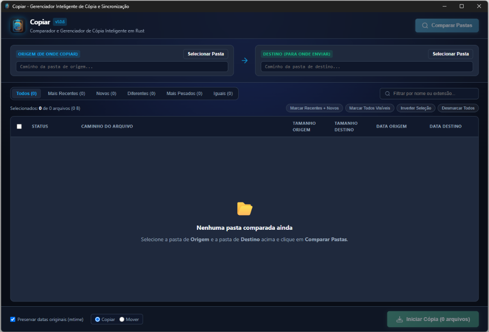
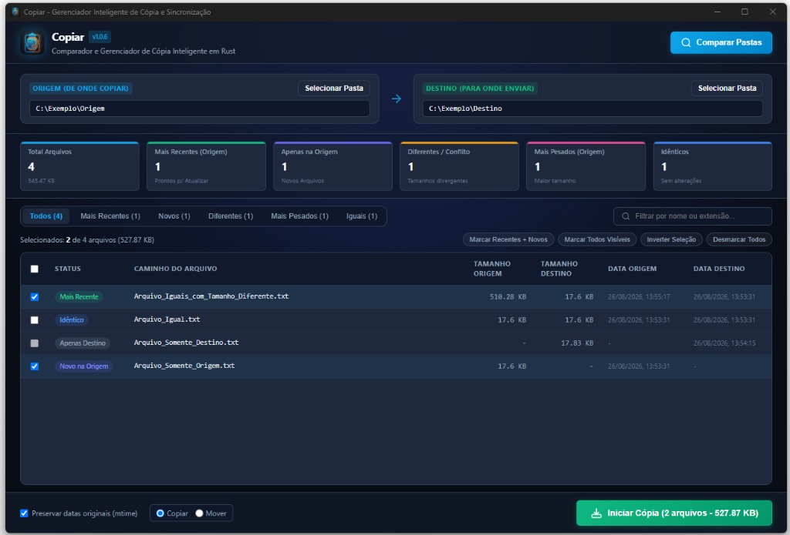

<div align="center">

# 🚀 Copiar — Fast File Sync & Directory Comparator

**Gerenciador e comparador inteligente de cópia e sincronização de arquivos para Windows, construído em Rust + Tauri v2.**

[](https://github.com/Blastoles/Copiar/releases/latest)
[](https://github.com/Blastoles/Copiar/releases/latest/download/copiar.exe)
[](https://www.rust-lang.org/)
[](https://tauri.app/)

[📥 Download Direto (.exe)](#-download-direto) •
[📸 Screenshots](#-screenshots) •
[⚡ Recursos Principais](#-recursos-principais) •
[🛠️ Como Executar](#️-como-executar) •
[🌐 English Summary](#-english-summary)

</div>

---

## 📥 Download Direto

Baixe e execute imediatamente no Windows sem precisar instalar dependências:

- 👉 **[Baixar `copiar.exe` (Última Versão Estável)](https://github.com/Blastoles/Copiar/releases/latest/download/copiar.exe)**
- 📦 Outras versões na aba **[Releases](https://github.com/Blastoles/Copiar/releases)**.

---

## 📸 Screenshots

### Tela Inicial (Aguardando Comparação)


### Comparação Concluída com Métricas e Diferenças


---

## ⚡ Recursos Principais

- **Varredura Paralela Ultrarrápida:** Usa `rayon` e `walkdir` em Rust para escanear centenas de milhares de arquivos em milissegundos.
- **Categorização Automática de Diferenças:**
  - 🟢 **Mais Recentes:** Arquivos na origem com data de modificação (`mtime`) superior ao destino.
  - 🟣 **Apenas na Origem:** Arquivos novos inexistentes no destino.
  - 🟡 **Diferentes / Conflito:** Arquivos com divergência de tamanho ou conteúdo.
  - 🌸 **Mais Pesados:** Arquivos com tamanho maior na origem.
  - 🔵 **Idênticos:** Arquivos já sincronizados.
- **Seleção Inteligente em Lote:** Botões de ação rápida para marcar somente atualizações, inverter seleção ou filtrar visíveis.
- **Tabela Virtualizada:** Suporta visualização fluida de listas gigantescas sem travar a interface.
- **Engine Nativa de Cópia e Movimentação:** Streaming assíncrono em chunks com reporte em tempo real de velocidade (`MB/s`), bytes transferidos e preservação exata de data original (`mtime`).

---

## 🛠️ Como Executar (Desenvolvimento)

### Pré-requisitos
- [Rust & Cargo](https://www.rust-lang.org/) (versão 1.75+)
- [Node.js](https://nodejs.org/) (opcional, para CLI do Tauri)

### 1. Instalar dependências da CLI Tauri
```bash
npm install
```

### 2. Rodar em Modo de Desenvolvimento
```bash
npm run dev
# ou
npx @tauri-apps/cli dev
```

### 3. Rodar Testes de Unidade da Engine Rust
```bash
cargo test --manifest-path src-tauri/Cargo.toml
```

### 4. Gerar Binário de Produção com Versionamento Automático
```powershell
# Incrementa a versão (ex: 1.0.0 -> 1.0.1) e faz o build completo
.\build.ps1

# Ou para incrementar versão minor (ex: 1.0.0 -> 1.1.0)
.\build.ps1 -IncrementType minor
```

---

## 🌐 English Summary

**Copiar** is a high-performance folder comparison and file synchronization desktop tool for Windows built with **Rust** and **Tauri v2**.

- **Parallel Directory Scanner**: Powered by `rayon` and `walkdir` to compare hundreds of thousands of files in milliseconds.
- **Smart Diff Categorization**: Automatically classifies files into *Newer*, *Source Only*, *Conflict/Different*, *Larger*, and *Identical*.
- **Chunked Async Copy/Move Engine**: Real-time `MB/s` throughput metrics while preserving original modification timestamps (`mtime`).

---

<div align="center">

Desenvolvido por **[Igor Cezario Pereira (Blastoles)](https://github.com/Blastoles)**  
Se este projeto foi útil para você, deixe uma ⭐ no repositório!

</div>
